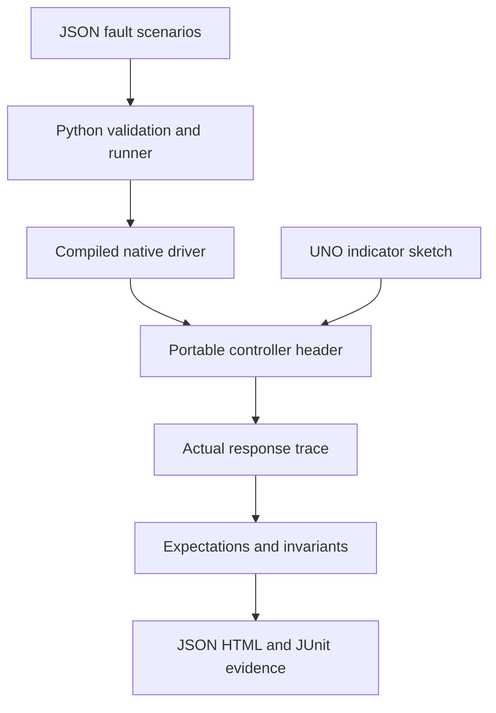

# Requirements, architecture and test protocol

The harness compiles real C++ code and starts a new driver process for each scenario. It does not substitute a Python controller model. Each scenario begins with a fresh BOOT controller; reboot coverage demonstrates a new instance is disarmed, not a measured MCU power cycle. Reports hash the header, driver and scenario input to identify what was exercised. Python runner changes are tracked by git/CI commit, not included in the core hash.

## State contract

| State | Permission | Exit behavior |
|---|---|---|
| BOOT | Off | R after qualification → READY |
| READY | Off | A after qualification → ACTIVE |
| ACTIVE | On if no faults | X → STOPPED; any fault → FAULT; qualified R → READY |
| STOPPED | Off | Qualified R → READY; A is ignored |
| FAULT | Off | Qualified R clears mask and enters READY |

Qualification: stop input closed; at least three healthy fresh samples since the last disqualifying sample/stop/stale event; last value ≤700; sensor age <500 ms; heartbeat age <300 ms. Samples in 701..799 do not trip but reset the qualification count. Healthy samples are counted when `fresh=true`; the adapter must only assert fresh for distinct acquisitions. The host may inject arbitrary frame spacing; the UNO samples at roughly 100 ms intervals. A previously active controller can remain active in 701..799 until it trips at 800.

## Fault bits

| Bit value | Name | Trigger |
|---|---|---|
| 1 | SENSOR_INVALID | Fresh sample marked invalid |
| 2 | RANGE | Fresh valid value outside 0..1000 |
| 4 | STALE | Age since last valid in-range sample ≥500 ms |
| 8 | HEARTBEAT | ACTIVE and heartbeat absent or age ≥300 ms |
| 16 | OVER_LIMIT | Fresh in-range value ≥800 |
| 32 | STOP_OPEN | Stop input open |
| 64 | BAD_COMMAND | Unsupported non-whitespace protocol byte |
| 128 | CLOCK | Backward time or per-step gap exceeding half uint32 range |

Masks accumulate until explicit qualified reset. Faults take precedence over commanded stop, so X during a fault remains FAULT. A valid-range high value refreshes sample age but cannot qualify for reset. Invalid/range samples do not refresh valid sample age. Missed sensor/heartbeat deadlines are checked **before** accepting late data; a sample/heartbeat arriving exactly at expiry cannot hide the gap. Reset can clear a heartbeat fault after a fresh heartbeat and otherwise healthy qualification, but cannot clear newly stale/invalid/range/stop faults until requalified.

All timing subtraction uses `uint32_t(now-then)`. Adjacent updates must be separated by less than 2^31 ms; a backward clock or larger step latches CLOCK and resets qualification. Normal wrap from a high uint32 timestamp to a low timestamp remains forward. The software cannot detect how many complete timer cycles elapsed without updates. No host wall-clock delay is used to enforce scenario time.

## Scenario schema v1

Top-level keys: `schema_version: 1`, `scenarios: [...]`. Each scenario has a unique lowercase/digit/hyphen `name`, a `purpose` and `steps`. The committed file is the executable example.

Every step must contain:

| Field | Type / meaning |
|---|---|
| time_ms | Integer 0..4294967295, virtual controller timestamp |
| fresh | Boolean, new acquisition event |
| valid | Boolean, adapter's sample validity flag |
| value | Signed 16-bit integer; values outside controller range deliberately inject a fault |
| stop_closed | Boolean, closed stop loop |
| command | One printable ASCII byte; `-` means no command |
| expect | Exact `state`, boolean `permit`, integer `faults`; optional `healthy_samples` |

The validator rejects unexpected fields, duplicate names, invalid types, files >2 MB, >100 scenarios or >10000 steps per scenario. Times may intentionally regress for CLOCK injection. The native driver consumes six whitespace-delimited fields per line and returns one JSON object per accepted frame. Structurally invalid native frames exit 2; the controller itself sees structurally valid but unsupported commands and trips BAD_COMMAND. Native process timeout is 10 seconds per scenario; compilation timeout 60 seconds.

## Mutation checks

The runner creates temporary header copies, removes one stale, heartbeat or threshold check, compiles each variant and requires at least one scenario to fail. A green baseline is required first. The committed header and UNO sketch are never changed. The result is evidence for those three regression classes; it is not a comprehensive mutation score. Host-only broken binaries are deleted with the temporary directory and are never flashed.

## Primary references

- [GCC instrumentation options](https://gcc.gnu.org/onlinedocs/gcc/Instrumentation-Options.html): undefined behavior instrumentation and fail-on-error configuration.
- [Arduino language reference](https://docs.arduino.cc/language-reference/): timing, integer types and GPIO interfaces.

These explain tool/platform behavior; the thresholds, state machine and test expectations are requirements authored specifically for this lab.
